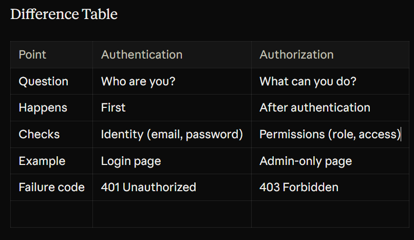

Authentication vs Authorization
What is Authentication (AuthN)?
Authentication means "Who are you?" The server checks that you are really the person you claim to be.
• Example: You enter email and password on Instagram. Instagram checks them. If they match, you are logged in.
• Common ways: password, OTP, fingerprint, Google login.
What is Authorization (AuthZ)?
Authorization means "What are you allowed to do?" After login, the server checks your permissions.
• Example: In a college website, a student can see marks, but only a teacher can edit marks. Both are logged in, but their permissions are different.
• Common ways: roles (admin, user), permissions, access rules.

Real Life Example
Think of an office building:
• Authentication = Guard checks your ID card at the gate. (Are you an employee?)
• Authorization = Your card opens only your floor, not the server room. (Where can you go?)
Login and Permission Flow

1.  User sends email and password to the server (Login request).
2.  Server finds the user in the database.
3.  Server compares the password. If wrong, send 401 error.
4.  If correct, server creates a token (for example JWT) and sends it back.
5.  User sends this token with every next request.
6.  Server verifies the token (Authentication).
7.  Server checks the user's role (Authorization).
8.  If allowed, send data. If not, send 403 error.

        Client --(email, password)--> Server
        Server --(check DB, compare password)--> OK
        Server --(token)--> Client
        Client --(request + token)--> Server
        Server --(verify token + check role)--> Allow or Deny

## Example

(npm i cookie-parser , express)

const express = require("express");
const cookieParser = require("cookie-parser");

const app = express();
app.use(express.json());
app.use(cookieParser());

// Hardcoded users (instead of a database)
const users = [
{ email: "admin@test.com", password: "123", role: "admin" },
{ email: "user@test.com", password: "123", role: "user" },
];

// LOGIN: checks who you are, then saves your info in a cookie
app.post("/login", (req, res) => {
const { email, password } = req.body;
const user = users.find((u) => u.email === email && u.password === password);

if (!user) return res.status(401).send("Wrong email or password");

res.cookie("email", user.email);
res.cookie("role", user.role);
res.send("Login successful");
});

// AUTHENTICATION: "Who are you?" -> is the user logged in?
function authenticate(req, res, next) {
if (!req.cookies.email) {
return res.status(401).send("Please login first"); // 401 = not logged in
}
next();
}

// AUTHORIZATION: "What can you do?" -> does the user have the right role?
function authorize(role) {
return (req, res, next) => {
if (req.cookies.role !== role) {
return res.status(403).send("You are not allowed"); // 403 = no permission
}
next();
};
}

// Any logged-in user can open this (only AuthN)
app.get("/profile", authenticate, (req, res) => {
res.send("Hello " + req.cookies.email);
});

// Only admin can open this (AuthN + AuthZ)
app.get("/admin", authenticate, authorize("admin"), (req, res) => {
res.send("Welcome Admin");
});

app.listen(3000, () => console.log("Running on http://localhost:3000"));
